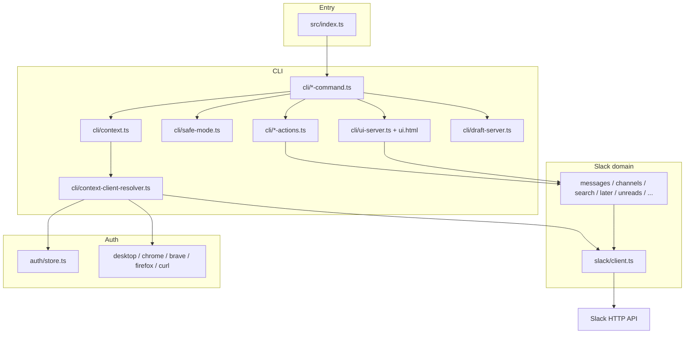

# slacki — architecture and testing

This guide covers Slacki's CLI and local browser surfaces. The repository also contains a separate hosted Next.js app and approval worker; see the [project guide](PROJECT_GUIDE.md) and [hosted setup](../apps/web/README.md).

Run from the repo:

```bash
bun install
bun run src/index.ts --help
```

Treat `slacki --help` and each subcommand’s help as the source of truth for flags.

---

## Shared control services

New paths: CLI action/automation commands and UI control routes → `core/service.ts`
→ exact workspace/target context → reusable policy → durable approval/execution
claim → `core/slack-execution.ts` → existing SlackApiClient → Slack.

`core/legacy-bridge.ts` adapts production message writes from existing CLI/UI
helpers into the same service while preserving successful Slack receipts.
`core/store.ts` persists actions and append-only lifecycle events together;
`core/workflow.ts` sequences validated steps and pauses for approval.
`core/workflow-history.ts` exposes durable invocation records and linked actions
to both CLI and UI; records share the existing local action store.
`core/planner.ts` only constructs bounded notification plans. Agent identity is
assigned by scoped server sessions, not trusted JSON fields.

See [control-plane boundaries and operation](CONTROL_PLANE.md) for the exact
capability migration boundary, trust model, idempotency and recovery limitations.
The existing domain modules and credential imports below remain in place.

## What the code is

Three jobs:

1. **Resolve auth** for a workspace (env token, saved credentials, or import from Slack Desktop / a browser).
2. **Call Slack** through one client wrapper, then shape the response for an agent (compact JSON, pruned empties, optional file downloads).
3. **Expose that** as Commander CLI commands, plus two localhost HTML surfaces (`ui` and the compose/draft editor).

The CLI and local surfaces do not use the hosted account database. CLI credentials live under `~/.config/slacki`; local control state and downloads live under `~/.slacki` (or their configured paths).

---

## Layout

```text
src/index.ts                 # Commander program, watchdog, command registration
src/cli/                     # commands, human-in-the-loop editors, local HTTP
src/slack/                   # Slack API wrappers and compact output
src/auth/                    # credentials store, Desktop/browser import, keychain
src/lib/                     # paths, JSON prune, version, update check
skills/slacki/               # agent skill (workflow only; not a flag catalog)
test/                        # bun:test, stubbed Slack, no live workspace required
bin/                         # entry shims (slacki.js, slacki.bun.js)
```

Entry: `src/index.ts` builds a Commander program, creates one `CliContext`, and registers every command. Most commands time out after 30s (`SLACKI_COMMAND_TIMEOUT_MS`). `ui`, `update`, and the interactive editors do not use that watchdog.

---

## Layers



**CLI (`src/cli/`)**  
Parses flags, enforces safe mode, and calls domain functions. Commands stay thin. Shared write paths live in `*-actions.ts` (`sendMessage`, compose, drafts).

**Context (`CliContext`)**  
The injectable handle tests stub. It owns workspace selection, client creation, auto-refresh of browser cookies, and auth imports. Production wiring is `createCliContext()` in `src/cli/context.ts`.

**Slack domain (`src/slack/`)**  
One function per Slack capability. Examples:

| Module        | Role                                                                     |
| ------------- | ------------------------------------------------------------------------ |
| `client.ts`   | `SlackApiClient` — `api()` / `apiMultipart()`, timeouts, rate-limit wait |
| `messages.ts` | history, thread, single message, compact form                            |
| `channels.ts` | list, resolve `#name` → id, mark read, create/invite                     |
| `search.ts`   | messages/files; downloads on unless the caller turns them off            |
| `later.ts`    | Slack Later (`saved.*`)                                                  |
| `unreads.ts`  | unread channels/DMs/threads                                              |
| `url.ts`      | parse Slack permalinks into workspace + channel + ts                     |

**Auth (`src/auth/`)**  
`credentials.json` is Zod-validated (`auth/schema.ts`). Two auth shapes:

- `standard` — `xoxb` / `xoxp` in `SLACK_TOKEN`
- `browser` — `xoxc` + `xoxd` cookie (Desktop or browser import)

Env wins when `SLACK_TOKEN` is set. Otherwise the resolver loads `~/.config/slacki/credentials.json`, matches `--workspace` / `SLACK_WORKSPACE_URL` / the default workspace, and can refresh a stale browser session from Desktop or Chrome.

---

## Auth and safety

**Workspace pick.** Channel _names_ (`#general`) are ambiguous if several workspaces are stored. Pass `--workspace`, set `SLACK_WORKSPACE_URL`, or run `auth set-default`. Channel _ids_ (`C…` / `D…` / `G…`) and message URLs do not need that.

**Safe mode.** `--safe-mode` or `SLACKI_SAFE_MODE=1` redirects `message send` to the draft editor and blocks the mutation list in `SAFE_MODE_BLOCKED_COMMANDS` (`src/cli/safe-mode.ts`). Slack-native drafts stay allowed (they post nothing). The controlled execution service also enforces safe mode; the local web app cannot use approval to override it.

**Secrets.** Doctor and error paths redact `xox*` tokens. Do not log `credentials.json` or keychain blobs.

---

## Local web app (`slacki ui`)

Not a hosted product. `startInboxUi` in `src/cli/ui-server.ts` binds **127.0.0.1 only** (default port **8787**). Open `http://127.0.0.1:8787` — `http://127.0.0.1/` is port 80 and will refuse unless something else is there.

On boot the server writes a random operator code to a private temporary file. Public HTML contains no session token. Unlock exchanges the code for a one-hour HttpOnly, SameSite=Strict cookie; the API also accepts the operator header for trusted local clients. Host/Origin checks reject cross-origin access. Scoped agent sessions cannot access human routes.

The page (`src/cli/ui.html`) is Inbox / Channels / Search / Later / Doctor. They share one message tape and composer.

| Method | Path                       | Slack / local work                          |
| ------ | -------------------------- | ------------------------------------------- |
| GET    | `/`                        | HTML + injected token                       |
| GET    | `/api/session`             | `auth.test`                                 |
| GET    | `/api/unreads`             | unreads; falls back to recent conversations |
| GET    | `/api/channels`            | `users.conversations`                       |
| GET    | `/api/history?channel=`    | channel history                             |
| GET    | `/api/thread?channel=&ts=` | thread replies                              |
| GET    | `/api/search?q=`           | message search, `download: false`           |
| GET    | `/api/later`               | Later items in progress                     |
| GET    | `/api/doctor`              | `collectDoctorReport` (no secrets)          |
| POST   | `/api/reply`               | `sendMessage` (channel + optional thread)   |
| POST   | `/api/mark`                | mark conversation read                      |
| POST   | `/api/later`               | save a message to Later                     |

Channel ids must match `C…` / `D…` / `G…`. Timestamps must look like `1234567890.123456`. Bodies over 1MB are rejected.

A second localhost server (`src/cli/draft-server.ts`) powers `message compose` / safe-mode send. Same idea: loopback + a one-off token.

---

## How a request moves

**CLI read** (example: `message list`):

1. Commander parses the target (URL or channel).
2. `getClientForWorkspace` picks auth.
3. `src/slack/messages.ts` calls Slack.
4. `toCompactMessage` + `pruneEmpty` print JSON.

**UI write** (example: Send):

1. Browser `POST /api/reply` with `x-inbox-token`.
2. Server validates channel + text.
3. `sendMessage` uses the same path as `message send`.
4. Slack `chat.postMessage`; UI reloads history or the thread.

---

## Testing

Automated tests do **not** need a Slack workspace. They stub `CliContext.getClientForWorkspace` (or call domain functions with a fake `client.api`). Opt-in read-only live verification is available in `scripts/live-smoke.ts`; mutations remain unverified.

### Automated (required before a change is done)

```bash
bun install
bun test
bun run typecheck
bun run lint
bun run format:check
```

One file:

```bash
bun test test/ui-server.test.ts
```

Filter:

```bash
bun test --test-name-pattern "channels, search"
```

`bun test` is Bun’s runner (`bun:test`). Pre-commit runs lint + format check.

### What the test files cover

| File                                                                                                    | Asserts                                                                                                  |
| ------------------------------------------------------------------------------------------------------- | -------------------------------------------------------------------------------------------------------- |
| `test/command-tree.test.ts`                                                                             | Public command paths match the frozen list; every safe-mode block exists                                 |
| `test/help-contracts.test.ts`                                                                           | Flag help text that agents depend on                                                                     |
| `test/ui-server.test.ts`                                                                                | Local web app: HTML, 401 without token, session/unreads/history/reply/mark, channels/search/later/doctor |
| `test/draft-server.test.ts`                                                                             | Compose/draft localhost editor                                                                           |
| `test/safe-mode.test.ts`                                                                                | Redirect send; block mutations                                                                           |
| `test/doctor.test.ts`                                                                                   | Report shape; no leaked tokens                                                                           |
| `test/client.test.ts`                                                                                   | Auth headers, timeouts, errors                                                                           |
| `test/messages.test.ts`                                                                                 | History/thread/compact                                                                                   |
| `test/channels.test.ts`                                                                                 | Resolve names, list, mark                                                                                |
| `test/channel-command.test.ts` / `channel-admin.test.ts`                                                | Create/invite wiring                                                                                     |
| `test/search-*.test.ts` / `search-command.test.ts`                                                      | Query build, message/file search, CLI wiring                                                             |
| `test/later.test.ts`                                                                                    | Later list/save/mark                                                                                     |
| `test/reactions.test.ts` / `message-reaction-filters.test.ts`                                           | Add/remove reactions and filters                                                                         |
| `test/message-compact.test.ts`                                                                          | Compact message shape                                                                                    |
| `test/targets.test.ts` / `url.test.ts`                                                                  | URL vs channel vs user                                                                                   |
| `test/workspace-selector.test.ts`                                                                       | `--workspace` matching                                                                                   |
| `test/desktop-auth-paths.test.ts`                                                                       | Slack Desktop path probe                                                                                 |
| `test/message-send.test.ts` / `format-outbound.test.ts`                                                 | Send + list → rich text                                                                                  |
| `test/drafts.test.ts` / `message-draft-actions.test.ts`                                                 | Slack-native drafts                                                                                      |
| `test/canvas-create.test.ts`                                                                            | Markdown → canvas                                                                                        |
| `test/users.test.ts` / `user-cache.test.ts` / `user-id.test.ts`                                         | Users                                                                                                    |
| `test/render.test.ts` / `mrkdwn.test.ts` / `rich-text.test.ts` / `html-to-md.test.ts` / `emoji.test.ts` | Text pipelines                                                                                           |
| `test/files.test.ts`                                                                                    | Downloads                                                                                                |
| `test/update.test.ts`                                                                                   | Self-update detection                                                                                    |
| `test/compact-json.test.ts` / `parse-limit.test.ts` / `leveldb-reader.test.ts`                          | Shared helpers                                                                                           |

When you add a CLI verb, update `EXPECTED_COMMANDS` in `test/command-tree.test.ts`. When you add a mutation, add it to `SAFE_MODE_BLOCKED_COMMANDS` and that test will fail until the tree includes it.

### What to test when you change something

**New or changed CLI command**

- Register it in `src/index.ts`.
- Extend `EXPECTED_COMMANDS`.
- If it mutates Slack, add it to safe-mode (or document why it is exempt).
- Add a unit test with a stub `client.api` that records method names.
- Check `--help` if you added a flag agents will copy.

**`src/slack/*`**

- Prefer tests next to the behavior (`test/<area>.test.ts`).
- Stub `client.api` / `apiMultipart` return values; assert the Slack method and the compact JSON.

**`src/cli/ui-server.ts` or `ui.html`**

- Automated: `test/ui-server.test.ts` — 401 on every new `/api/*` route, 200 + Slack method for the happy path, invalid channel/ts → 400/500 with no token leak.
- Manual (needs `slacki auth test` already working):

  ```bash
  bun run src/index.ts ui --port 8787
  ```

  Then open **http://127.0.0.1:8787** (not port 80).

  Walk this:
  1. Inbox loads a queue; open a channel; reply; mark read.
  2. Channels lists conversations; open one; send.
  3. Search a word you know exists; open a hit.
  4. Save Later from the tape; Later tab shows it.
  5. Doctor shows next steps / report, no `xox` strings.
  6. A request without `x-inbox-token` stays 401 (the page itself is enough if the UI works).
  7. Stop with Ctrl+C; reload should fail.

**Auth / credentials**

- Prefer `doctor` and the desktop-path tests over hitting a real Slack in CI.
- Manual: `auth import-desktop` (or chrome/brave/firefox), then `auth test`, then `doctor`.

**Do not**

- Point automated tests at a real workspace.
- Commit `credentials.json`, cookies, or tokens.
- Treat the UI as remotely reachable — it is loopback by design.

---

## Manual smoke (after clone)

```bash
bun install
bun run src/index.ts doctor
bun run src/index.ts auth test
bun run src/index.ts unreads --counts-only
bun run src/index.ts ui --port 8787
```

If doctor says there is no session, import Desktop or a browser, or set `SLACK_TOKEN` (and `SLACK_COOKIE_D` for `xoxc-`).
