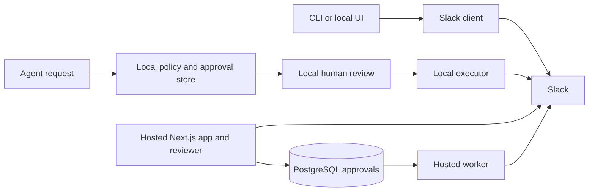

# Slacki project guide

Slacki connects Slack to command-line tools, people, and agents. It reduces repetitive Slack work while keeping controlled changes reviewable by a person.

## What it does

- Reads messages, threads, channels, users, files, unread items, saved Later items, and Slack canvases.
- Provides a local CLI, inbox UI, and control center.
- Lets scoped agents request structured actions. Policy checks and human review precede controlled execution.
- Includes a separate hosted workspace dashboard for Slack OAuth, joined-channel reading, and approved messages/channel changes.

Slacki does not include an AI model or agent runtime. An external agent may call its CLI/control API; Slacki handles targeting, policy, persistence, and execution.

## Architecture

The CLI runs through Bun/TypeScript. It stores local credentials and control state on disk. The hosted Next.js app uses Slack OAuth and PostgreSQL (deployment docs use Neon); a separate Node worker claims and executes approved hosted actions. Hosted tokens are encrypted in the database.

| Area                                          | Main code                                  |
| --------------------------------------------- | ------------------------------------------ |
| CLI commands and local HTTP UIs               | `src/index.ts`, `src/cli/`                 |
| Slack methods and response shaping            | `src/slack/`                               |
| Authentication and browser imports            | `src/auth/`                                |
| Policy, actions, local persistence, workflows | `src/core/`                                |
| Hosted dashboard, OAuth routes, migrations    | `apps/web/src/`, `apps/web/migrations/`    |
| Hosted approved-action worker                 | `apps/worker/index.mjs`                    |
| Automated tests and mock fixture              | `test/`, `e2e/`, `scripts/mock-control.ts` |

## Request flow

1. The CLI resolves a workspace from a saved credential, supported environment token, or imported Slack session.
2. Read commands call Slack and print compact JSON; local UI requests reuse the same context.
3. Controlled write requests are validated and checked against policy. An agent cannot self-approve.
4. A person reviews the request. The local executor or hosted worker executes it and records the outcome.

## Current status

| Surface                                                  | Status                                                                                                                                                                      |
| -------------------------------------------------------- | --------------------------------------------------------------------------------------------------------------------------------------------------------------------------- |
| CLI, local UI, control/policy/workflow logic             | Implemented; unit tests use fake Slack clients. Live Slack behavior requires workspace credentials.                                                                         |
| Hosted web app                                           | Routes, OAuth flow, dashboard, and migrations are implemented; requires configured Slack OAuth and PostgreSQL. Live deployment was not verified in this documentation pass. |
| Hosted worker                                            | Implemented as a polling Node service; requires the same database, encryption key, and Slack OAuth credentials. Live worker execution was not verified.                     |
| Browser E2E                                              | Implemented and passing against a mock Slack fixture only. It does not contact a real workspace.                                                                            |
| Slack-native drafts, Later, some unread/workflow methods | Depend on Slack web-client methods that are not all part of Slack's documented public Web API; compatibility may change.                                                    |

No model provider, analytics service, or telemetry collection backend is configured in the application.
